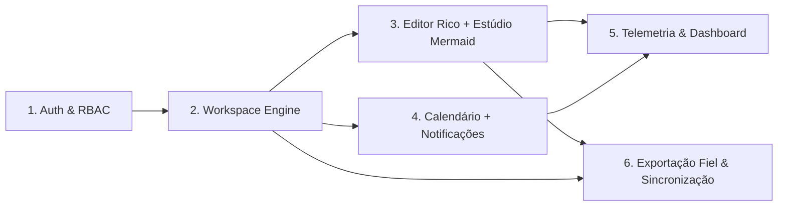

# Arquitetura do Vellum — Os 6 Módulos

> © 2026 Vellum · Arquitetado e Desenvolvido por Leonardo Barreiras. Todos os direitos reservados.
> Complementa o `CLAUDE.md`. Em caso de conflito, prevalece o `CLAUDE.md`.

---

## Visão geral

Os módulos são uma divisão **lógica**, não pastas separadas: a interface de cada um vive em `src/components/<área>/` e em `src/app/(workspace)/<rota>/_components/`, e as regras e serviços em `src/lib/` (`rbac.ts`, `auth*.ts`, `workspace-store.ts`, `store/` com os repositórios `json` e `postgres`, `calendar.ts`, `telemetry.ts`, `exporters/`, `sync/`). A autorização (RBAC) do Módulo 1 é transversal e verificada no repositório (`workspace-store.ts`) em todas as Server Actions; o repositório nunca confia no cliente.

### Segurança em camadas (estado atual)

- **Pedidos:** `middleware.ts` protege as rotas privadas e gera um *nonce* por pedido para a Content-Security-Policy (`src/lib/csp.ts`; `VELLUM_CSP=report-only|off` como válvula de escape). `next.config.ts` acrescenta HSTS (só em produção), COOP, Permissions-Policy e restantes cabeçalhos.
- **Abuso:** limitador de taxa em janela fixa com várias regras por pedido — IP, conta+IP e conta (`src/lib/rate-limit.ts`) — aplicado ao login, registo, códigos, desbloqueio de links partilhados e PDF. O IP do cliente lê-se do `X-Forwarded-For` a partir da direita (`VELLUM_PROXY_HOPS`).
- **Contas:** `scrypt2$N$r$p$…` (N=2^15) com atualização transparente de hashes antigos no login; respostas sem enumeração de utilizadores; `?next=` validado por `safeNextPath`. Perfis de demonstração desligados em produção (ver README).
- **Conteúdo:** o JSON do editor passa por uma lista fechada de nós/marcas/atributos (`document-content.ts`) à entrada e é revalidado à saída (`storedContent` em `workspace-store.ts`: editor, conflito, exportação e links; se falhar, devolve-se o texto simples); as ligações passam por `safeHref`; Mermaid em modo `strict`.
- **Dados:** o instantâneo enviado ao cliente não leva o conteúdo rico dos documentos; este é pedido por documento (`getDocumentContent`, com verificação de permissão).
- **Testes herméticos:** `tests/support/hermetic-env.ts` limpa as variáveis da aplicação antes de cada ficheiro (nunca BD nem email reais); `npm run test:pg` corre a suite do repositório sobre PostgreSQL (`tests/support/pg-env.ts` só aceita bases com «e2e»/«test» no nome) e `scripts/check-integrity.mjs` verifica linhas órfãs.
- **Limite conhecido:** o repositório mantém o atelier inteiro em memória com um bloqueio global por escrita (adequado a um processo único; um segundo réplica exigiria transações por linha).

---

## Módulo 1 — Auth & RBAC (Login Animado por Caneta SVG)

**Objetivo:** autenticação segura com uma experiência de entrada memorável.

- **Better-Auth** com email/palavra-passe, magic link e OAuth (Google, GitHub).
- **RBAC** com papéis por workspace: `owner`, `admin`, `editor`, `commenter`, `viewer`.
- Permissões granulares (`page:read`, `page:write`, `project:manage`, `member:invite`, …) mapeadas por papel; helper `can(user, action, resource)`.
- **Login Animado por Caneta SVG:** ao carregar o ecrã de entrada, uma caneta de tinta permanente desenha a assinatura "Vellum" com `stroke-dasharray`/`stroke-dashoffset` animados via Framer Motion, sobre fundo papel creme. Respeita `prefers-reduced-motion` (mostra o logótipo estático).
- Sessões em base de dados; proteção de rotas via `middleware.ts`.

**Modelos Prisma:** `User`, `Session`, `Account`, `Verification`, `Workspace`, `Membership (role)`.

---

## Módulo 2 — Workspace Engine (Projetos, Páginas, Notas)

**Objetivo:** organização hierárquica inspirada no OneNote com a flexibilidade do Notion.

- Hierarquia: **Workspace → Projeto → Página → Subpáginas** (árvore ilimitada) e **Notas** rápidas (soltas ou ligadas a páginas).
- Barra lateral com árvore arrastável (drag & drop), favoritos, recentes e lixo (eliminação lógica com recuperação 30 dias).
- Pesquisa global (`⌘K`) com full-text PostgreSQL (`tsvector`, configuração `portuguese`).
- Ícones e capas por página; etiquetas (tags) e ligações entre páginas (backlinks).
- Partilha por página com herança de permissões do projeto.

**Modelos Prisma:** `Project`, `Page (parentId, position)`, `Note`, `Tag`, `PageLink`, `Favorite`.

---

## Módulo 3 — Editor Rico Word/Notion + Estúdio Mermaid

**Objetivo:** escrever com a fluidez do Notion e o rigor do Word.

- **TipTap v2** com blocos: títulos, parágrafos, listas, checklists, tabelas, citações, callouts, imagens, código (realce de sintaxe), fórmulas, separadores e quebras de página.
- **Modo Documento (Word):** vista paginada A4/Letter com margens, cabeçalhos/rodapés, numeração de páginas, estilos de parágrafo nomeados e índice automático.
- **Modo Bloco (Notion):** menu `/`, arrastar blocos, conversão de tipos de bloco.
- Conteúdo guardado como **JSON ProseMirror** (fonte de verdade), versões com histórico e restauro.
- **Estúdio Mermaid:** bloco dedicado com editor de código (JetBrains Mono) e pré-visualização em tempo real lado a lado, temas Mermaid alinhados com os tokens Creme, exportação SVG/PNG.
- Auto-guardar com debounce e indicador de estado ("A guardar…" / "Guardado").

**Modelos Prisma:** `PageContent (json)`, `PageVersion`, `Comment`.

---

## Módulo 4 — Calendário Personalizável + Notificações

**Objetivo:** ligar o conhecimento ao tempo.

- **Calendário próprio** (`src/components/calendar`) com vistas semana, mês e agenda; cores de eventos derivadas dos tokens do tema.
- Eventos ligados a páginas/projetos; tarefas com data de entrega extraídas de checklists.
- Recorrência (RRULE), lembretes e categorias personalizáveis.
- **Notificações:** centro de notificações in-app, menções (`@utilizador`), lembretes, convites; preferências por canal (in-app / email).
- Importação/exportação ICS.

**Modelos Prisma:** `CalendarEvent`, `EventReminder`, `Notification`, `NotificationPreference`.

---

## Módulo 5 — Telemetria de Esforço & Dashboard

**Objetivo:** dar visibilidade ao trabalho realizado, de forma privada e útil.

- Recolha de **telemetria de esforço**: tempo ativo de edição (heartbeats com deteção de inatividade), palavras escritas, páginas criadas/editadas, tarefas concluídas.
- Dados agregados por dia/projeto; nunca regista conteúdo, apenas métricas.
- **Dashboard** com componentes próprios, sem biblioteca de gráficos: tempo por projeto, sequência (streak) de escrita, mapa de calor de atividade (`ConsistencyHeatmap`).
- O utilizador controla a recolha (ativar/desativar, exportar, apagar os seus dados).

**Modelos Prisma:** `ActivitySession`, `EffortMetricDaily`.

---

## Módulo 6 — Exportação Fiel & Sincronização

**Objetivo:** o que se vê no Vellum é exatamente o que sai do Vellum.

- **PDF:** renderização server-side com **Playwright** (Chromium headless) da vista paginada, com fontes incorporadas e CSS de impressão.
- **DOCX:** conversão do JSON ProseMirror com a biblioteca **`docx`**, mapeando estilos de parágrafo, tabelas, listas, cabeçalhos/rodapés e quebras de página — **sem desformatação**.
- **Markdown/HTML** para interoperabilidade; importação de Markdown e DOCX.
- Testes de regressão visual (Playwright) para garantir fidelidade da exportação.
- **Sincronização:** atualizações otimistas, fila offline (`localStorage`, por conta e apagada ao terminar sessão) e resolução de conflitos por versão; preparado para colaboração em tempo real (Yjs) numa fase posterior.

**Modelos Prisma:** `ExportJob`, `SyncCursor`.

---

## Transversal

- **Footer** global com o aviso de direitos reservados (ver `CLAUDE.md` §8).
- **Temas:** os 5 temas curados aplicam-se a todos os módulos, incluindo Mermaid e o calendário.
- **i18n:** PT-PT como idioma base.

---

© 2026 Vellum · Arquitetado e Desenvolvido por Leonardo Barreiras. Todos os direitos reservados.
