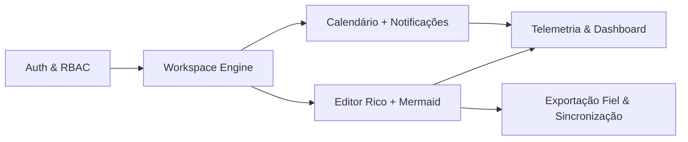

<div align="center">

# Vellum

### Workspace & Knowledge Platform

**A flexibilidade do Notion · a organização do OneNote · o rigor do Word.**


</div>

---

## Sumário Executivo

O **Vellum** é uma plataforma web de workspace e gestão de conhecimento pensada para quem escreve, planeia e documenta a sério. Junta num único ambiente a **edição por blocos** popularizada pelo Notion, a **organização hierárquica** em cadernos e secções do OneNote e a **fidelidade de paginação e formatação** do Microsoft Word, com uma identidade visual calma, inspirada em papel, em tons creme.

## Visão de Mercado

As ferramentas de conhecimento atuais obrigam a escolher entre flexibilidade e rigor:

| Problema                                                   | Resposta do Vellum                                                  |
| ---------------------------------------------------------- | ------------------------------------------------------------------- |
| Editores por blocos perdem a formatação ao exportar        | **Exportação fiel** para DOCX e PDF, sem desformatação              |
| Processadores de texto não organizam conhecimento          | **Workspace hierárquico** com projetos, páginas, notas e backlinks  |
| Diagramas vivem fora dos documentos                        | **Estúdio Mermaid** integrado no editor                             |
| Planeamento e escrita estão em aplicações separadas        | **Calendário** ligado a páginas e tarefas                           |
| Não há visibilidade sobre o esforço investido              | **Telemetria de esforço** privada com dashboard                     |
| Interfaces frias e cansativas para sessões longas          | **Design System em tons creme** com 5 temas curados                 |

**Público-alvo:** profissionais do conhecimento, investigadores, estudantes, consultores e equipas pequenas que precisam de produzir documentos formais a partir de notas vivas.

## Funcionalidades

| Módulo | Funcionalidade                          | Destaques                                                                 |
| :----: | --------------------------------------- | ------------------------------------------------------------------------- |
| 1      | **Auth & RBAC**                         | Better-Auth, papéis por workspace, login animado por caneta SVG           |
| 2      | **Workspace Engine**                    | Projetos, páginas aninhadas, notas, pesquisa `⌘K`, favoritos, lixo        |
| 3      | **Editor Rico + Estúdio Mermaid**       | TipTap v2, modo bloco e modo documento paginado, diagramas em tempo real  |
| 4      | **Calendário + Notificações**           | FullCalendar, recorrência, lembretes, ICS, centro de notificações         |
| 5      | **Telemetria de Esforço & Dashboard**   | Tempo ativo, streaks, mapa de calor, gráficos Recharts                    |
| 6      | **Exportação Fiel & Sincronização**     | PDF via Playwright, DOCX via `docx`, Markdown, fila offline               |

## Arquitetura Técnica

| Camada         | Tecnologia                                                     |
| -------------- | -------------------------------------------------------------- |
| Framework      | Next.js 15 (App Router, React Server Components)               |
| Linguagem      | TypeScript (strict)                                            |
| Interface      | Tailwind CSS · shadcn/ui · Framer Motion                       |
| Dados          | PostgreSQL · Prisma ORM                                        |
| Autenticação   | Better-Auth com RBAC                                           |
| Editor         | TipTap v2 (ProseMirror) · Mermaid.js                           |
| Planeamento    | FullCalendar                                                   |
| Analítica      | Recharts                                                       |
| Exportação     | Playwright (PDF) · `docx` (Word)                               |



## Estrutura Modular

```
vellum/
├── .claude/
│   ├── ARCHITECTURE.md     # Detalhe dos 6 módulos
│   └── PROGRESS.md         # Roadmap e checklist das fases
├── prisma/                 # Esquema e migrações
├── src/
│   ├── app/                # Rotas (App Router)
│   ├── modules/
│   │   ├── auth/           # 1 · Auth & RBAC
│   │   ├── workspace/      # 2 · Workspace Engine
│   │   ├── editor/         # 3 · Editor Rico + Estúdio Mermaid
│   │   ├── calendar/       # 4 · Calendário + Notificações
│   │   ├── telemetry/      # 5 · Telemetria & Dashboard
│   │   └── export/         # 6 · Exportação & Sincronização
│   ├── components/         # UI partilhada (shadcn/ui, layout, Footer)
│   ├── lib/                # Prisma, auth, utilitários
│   └── styles/             # Tokens e temas
├── CLAUDE.md               # Regras de arquitetura
├── LICENSE                 # Licença proprietária
└── README.md
```

## Design System

Identidade em **tons creme**, definida por variáveis CSS. Tema padrão **Warm Cream**:

| Token              | Cor       |
| ------------------ | --------- |
| `--bg-canvas`      | `#FAF7F2` |
| `--bg-surface`     | `#F2ECE1` |
| `--bg-elevated`    | `#FFFFFF` |
| `--text-primary`   | `#1C1B18` |
| `--text-muted`     | `#6E6A63` |
| `--accent-primary` | `#C85A32` |
| `--border-subtle`  | `#E4DDD0` |

**Temas curados:** `warm-cream` · `sage-paper` · `nordic-slate` · `sand-dune` · `dark-espresso`
**Tipografia:** Newsreader (serif) · Plus Jakarta Sans (sans) · JetBrains Mono (mono)

## Roadmap

| Fase | Âmbito                                              | Estado        |
| :--: | --------------------------------------------------- | ------------- |
| 0    | Governação e fundação documental                    | ✅ Concluída  |
| 1    | Fundação técnica (Next.js, temas, Prisma, App Shell)| ⏳ Próxima    |
| 2    | Auth & RBAC · Workspace Engine                      | ○ Planeada    |
| 3    | Editor Rico · Estúdio Mermaid                       | ○ Planeada    |
| 4    | Calendário · Telemetria & Dashboard                 | ○ Planeada    |
| 5    | Exportação Fiel · Sincronização · Lançamento        | ○ Planeada    |

Detalhe completo em [`.claude/PROGRESS.md`](.claude/PROGRESS.md).

## Licenciamento

> **Este projeto NÃO é open source.**

O Vellum é distribuído sob uma **Licença Proprietária de Código Visível — Todos os Direitos Reservados**. O repositório é público **exclusivamente para visualização e portefólio**.

Sem autorização expressa e por escrito de Leonardo Barreiras, é **proibido**:

- copiar ou reutilizar o código para fins comerciais;
- redistribuir, sublicenciar ou vender o software;
- criar produtos ou obras derivadas;
- remover créditos, avisos de copyright ou footers.

Consulte o ficheiro [`LICENSE`](LICENSE) para os termos completos (PT + EN). Pedidos de licenciamento: [github.com/leobarreiras00](https://github.com/leobarreiras00).

---

<div align="center">

**Vellum** — Workspace & Knowledge Platform

© 2026 Vellum · Arquitetado e Desenvolvido por Leonardo Barreiras (Leo Barreiras). Todos os direitos reservados.

<sub>Licença proprietária · Uso comercial, redistribuição e obras derivadas proibidos sem autorização escrita.</sub>

</div>
